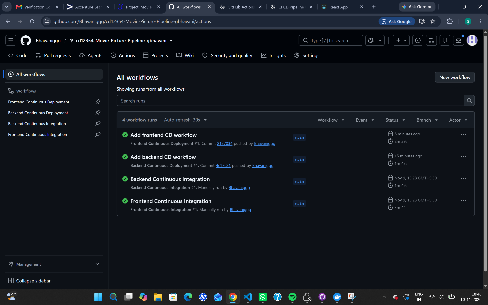
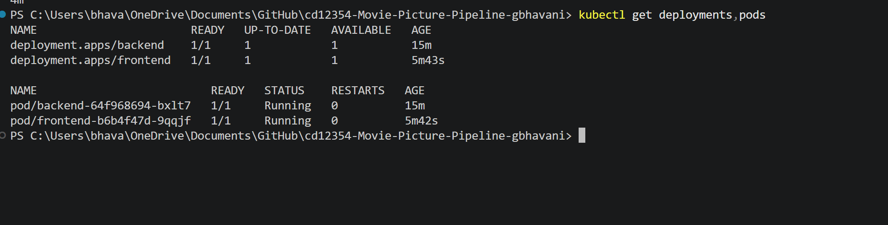
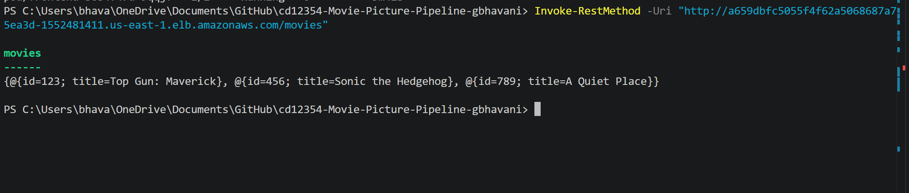
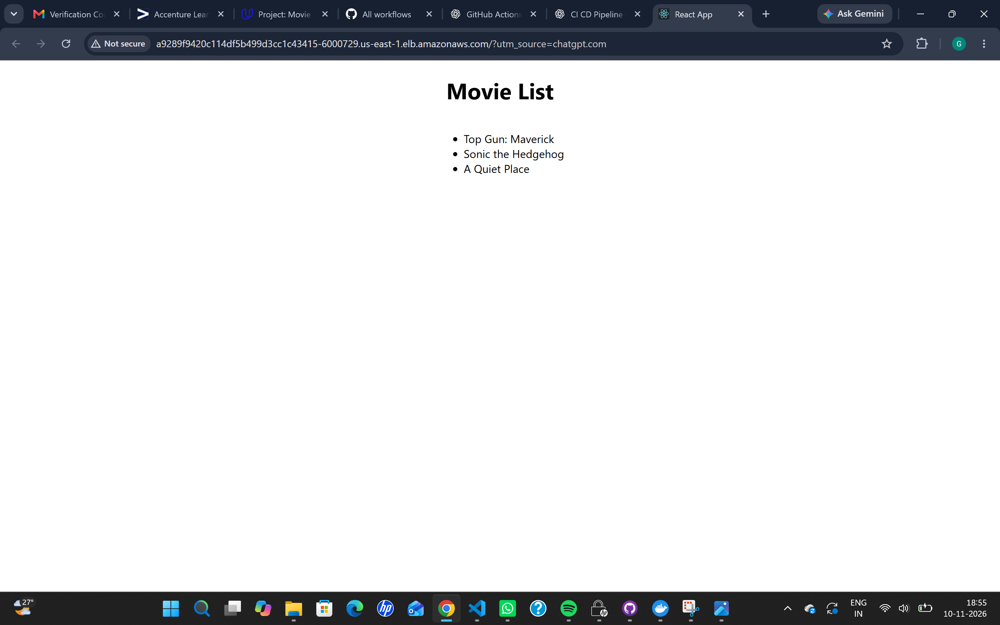
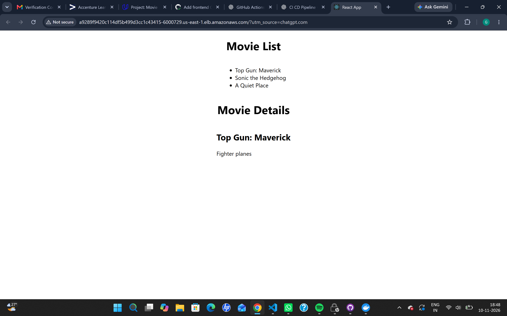

# Movie Picture – CI/CD Pipeline

## Project Overview

This project implements an automated Continuous Integration and Continuous Deployment (CI/CD) pipeline for a Movie Picture web application using GitHub Actions, Docker, Amazon ECR, Amazon EKS, and Kubernetes.

The application consists of two components:

- **Frontend:** React application written in TypeScript.
- **Backend:** REST API developed using Python and Flask.

The pipelines automate code validation, testing, Docker image creation, publishing images to Amazon ECR, and deploying applications to an Amazon EKS Kubernetes cluster.

## Technologies Used

| Category | Technologies |
|---|---|
| Frontend | React, TypeScript, Node.js |
| Backend | Python, Flask |
| CI/CD | GitHub Actions |
| Containers | Docker |
| Container Registry | Amazon ECR |
| Cloud Platform | AWS |
| Container Orchestration | Kubernetes, Amazon EKS |
| Infrastructure as Code | Terraform |
| Kubernetes Configuration | kubectl, Kustomize |
| Testing | Jest, Pytest |
| Linting | ESLint, Python linting tools |

## Project Structure

```text
Movie-Picture-Pipeline/
│
├── .github/
│   └── workflows/
│       ├── frontend-ci.yaml
│       ├── backend-ci.yaml
│       ├── frontend-cd.yaml
│       └── backend-cd.yaml
│
├── setup/
│   └── terraform/
│
├── starter/
│   ├── frontend/
│   │   ├── src/
│   │   ├── k8s/
│   │   └── Dockerfile
│   │
│   └── backend/
│       ├── movies/
│       ├── k8s/
│       └── Dockerfile
│
├── screenshots/
│   ├── github-actions-workflows.png
│   ├── kubernetes-deployments-pods.png
│   ├── backend-api-output.png
│   ├── frontend-movie-list.png
│   └── frontend-movie-details.png
│
└── README.md
```

## CI/CD Pipeline Implementation

### 1. Frontend Continuous Integration

Workflow: `.github/workflows/frontend-ci.yaml`

Triggers:
- Pull requests targeting the `main` branch.
- Manual execution using GitHub Actions.

Jobs:
- **Lint:** Checks frontend code using ESLint.
- **Test:** Executes frontend test cases.
- **Build:** Runs only after the lint and test jobs succeed and builds the Docker image.

Linting and testing execute in parallel. Dependency caching is used to improve workflow efficiency.

### 2. Backend Continuous Integration

Workflow: `.github/workflows/backend-ci.yaml`

Triggers:
- Pull requests targeting the `main` branch.
- Manual execution using GitHub Actions.

Jobs:
- **Lint:** Checks backend code.
- **Test:** Runs backend test cases using Pytest.
- **Build:** Builds the backend Docker image after successful linting and testing.

Linting and testing execute in parallel.

### 3. Frontend Continuous Deployment

Workflow: `.github/workflows/frontend-cd.yaml`

Triggers:
- Pushes to the `main` branch.
- Manual execution using GitHub Actions.

Pipeline steps:
1. Checkout the source code.
2. Run frontend linting.
3. Execute frontend tests.
4. Configure AWS credentials using GitHub Secrets.
5. Authenticate with Amazon ECR.
6. Build the Docker image using the `REACT_APP_MOVIE_API_URL` build argument.
7. Tag the image using the Git commit SHA.
8. Push the Docker image to Amazon ECR.
9. Apply Kubernetes manifests to Amazon EKS.
10. Update the frontend deployment with the newly built image.
11. Verify the Kubernetes deployment.

### 4. Backend Continuous Deployment

Workflow: `.github/workflows/backend-cd.yaml`

Triggers:
- Pushes to the `main` branch.
- Manual execution using GitHub Actions.

Pipeline steps:
1. Checkout the source code.
2. Run backend linting.
3. Execute backend tests.
4. Configure AWS credentials using GitHub Secrets.
5. Authenticate with Amazon ECR.
6. Build and tag the backend Docker image using the Git commit SHA.
7. Push the image to Amazon ECR.
8. Apply Kubernetes manifests to Amazon EKS.
9. Update the backend deployment with the new image.
10. Verify the deployment and running pods.

## AWS and Kubernetes Deployment

Terraform is used to provision the AWS infrastructure required for deployment.

Infrastructure includes:
- Amazon EKS Kubernetes cluster.
- EC2 worker node.
- Amazon ECR repositories for frontend and backend images.
- VPC and networking resources.
- IAM permissions and EKS access configuration.

Kubernetes manifests define the frontend and backend deployments and LoadBalancer services.

The GitHub Actions workflows deploy the application using `kubectl` and update the deployments with the Docker images published to ECR.

## Application Verification

The deployed application was tested successfully.

### Frontend

The frontend displays the movie list:
- Top Gun: Maverick
- Sonic the Hedgehog
- A Quiet Place

The movie details page was also verified.

### Backend API

The backend API was tested using the `/movies` endpoint and successfully returned the movie list.

## Screenshots and Evidence

The following screenshots demonstrate the successful implementation and deployment.

### GitHub Actions Workflows



### Kubernetes Deployments and Pods



### Backend API Response



### Frontend Movie List



### Frontend Movie Details



## Security

- AWS credentials are stored securely as GitHub repository Secrets.
- AWS access keys and session tokens are not hardcoded in workflow files.
- Docker images are published to private Amazon ECR repositories.
- GitHub Actions uses the configured AWS credentials to access the required AWS resources.

## Key Learning Outcomes

- Designing CI/CD pipelines using GitHub Actions.
- Automating frontend and backend linting and testing.
- Building and managing Docker images.
- Publishing container images to Amazon ECR.
- Deploying containerized applications to Amazon EKS.
- Managing Kubernetes deployments and services.
- Provisioning AWS infrastructure using Terraform.
- Managing secrets securely in GitHub Actions.

## Conclusion

This project demonstrates an end-to-end CI/CD implementation for a full-stack application. It automates testing, containerization, image publishing, and Kubernetes deployment, making the application deployment process more reliable and repeatable.
